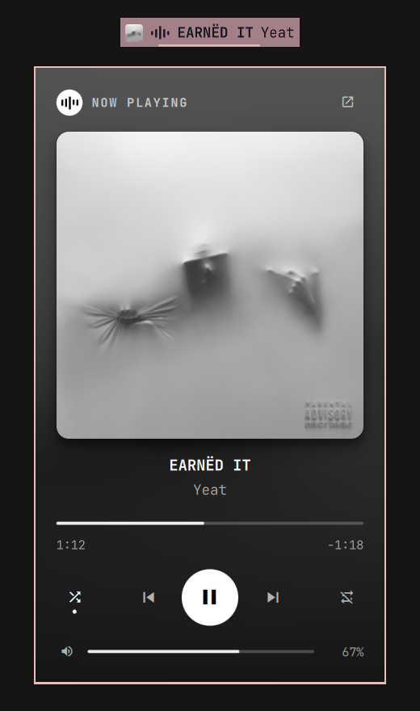

# Sonora for Omarchy

A Sonora-styled mini player for the [Omarchy](https://omarchy.org) bar, for
[Sonora](https://aur.archlinux.org/packages/sonora-bin), the native music streaming client.
Talks to Sonora over MPRIS (`org.mpris.MediaPlayer2.sonora`), so nothing extra is needed.



## Features

- **In the bar:** Sonora's five-bar waveform logo that dances while music plays, a cover-art
  thumbnail, a bold title with a dimmed artist (gently ping-pong scrolls when long) and a
  hairline progress bar
- Left click play/pause · middle click next · scroll prev/next · right click the card
- **Now Playing card**, modelled on Sonora's now-playing view: ambient backdrop blurred from
  the current cover, large rounded art, centered title and artist, slim scrubber with
  elapsed / remaining time, a white play disc, shuffle and repeat (off → all → one),
  and Sonora's own volume. Click the art or the ↗ icon to bring Sonora to the front
- Uses Inter (Sonora's typeface) in the card when it's installed
- OSD feedback and IPC for keybindings

## Requirements

- Omarchy with the plugin-capable shell (`omarchy plugin` available)
- [Sonora](https://aur.archlinux.org/packages/sonora-bin), e.g. `omarchy pkg aur add sonora-bin`

No other dependencies: playback state and controls go through the MPRIS player Sonora
already registers on the session bus.

## Install

```bash
omarchy plugin add https://github.com/TasosK7/omarchy-sonora.git --enable
```

Then place the **Sonora** widget from the Omarchy bar settings (category *Media*) if it
isn't already on your bar.

## Remove

```bash
omarchy plugin remove io.github.tasosk7.sonora
```

## IPC / keybindings

```bash
omarchy-shell sonora playPause   # also play, pause, stop, next, previous
omarchy-shell sonora shuffle     # toggle shuffle
omarchy-shell sonora repeat      # cycle repeat: none -> playlist -> track
omarchy-shell sonora seek 10     # relative seek in seconds (negative goes back)
omarchy-shell sonora volume 60   # Sonora player volume, 0-100
omarchy-shell sonora focus       # focus or launch Sonora
omarchy-shell sonora status      # JSON state
omarchy-shell shell toggle io.github.tasosk7.sonora ''   # open/close the popup
```

Example in `~/.config/hypr/bindings.lua`: bind a key to `omarchy-shell sonora playPause`.

## Settings

| Setting | Default | Description |
|---|---|---|
| Max label width | 180 px | Width before the label scrolls |
| Hide when not running | on | Remove the widget while Sonora is closed |
| Show artist in the bar | on | Append the artist to the bar label |
| Show cover art in the bar | on | Small album-art thumbnail next to the waveform |
| Show progress line | on | Hairline playback progress under the widget |

## License

MIT
